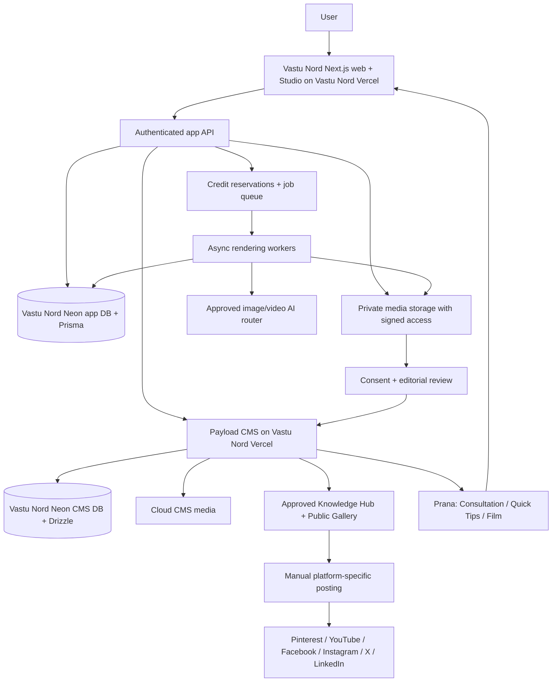

# Vastu Nord — target isolated architecture (not yet deployed)

**Never connect to NRide resources.** Vastu Nord's public gallery consent does not authorize social publishing by itself. Per-channel opt-in, rights checking, human review, and derived watermarked media are required.

**Communication:** browser ↔ HTTPS/SSE via Vastu Nord backend; typed module calls and transactional Neon writes; durable queue for real image/video AI work; Payload's cloud API plus publication hooks for reviewed content; **manual** native-platform uploads and recording of published IDs/links in Payload for now. Payment webhooks must be verified and idempotent.

**Future social integration:** `SocialPublisherAdapter` is only an interface with disabled implementation; Postiz is neither connected nor billed at this stage.

**Data ownership:** app Neon owns users/projects/credits/consent; Payload CMS owns published editorial records in its own database; object storage owns media bytes; cloud providers own payment and social post state. No cross-company sync.
