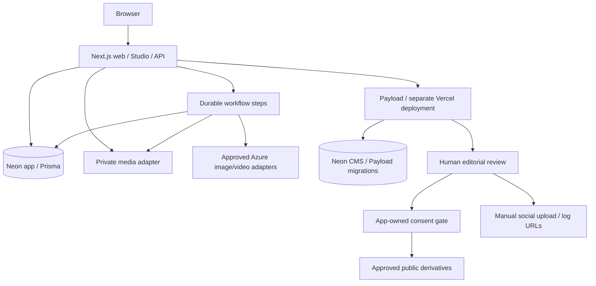

# Vastu Nord architecture — Phase 02A

**PLANNED, 2026-11-21.** No application or cloud setup verified. Phase 01 documentation passed with limitations; exact visual parity remains BLOCKED. Decisions and approval status: [DECISIONS.md](DECISIONS.md).

## Boundaries

Use a lightweight workspace: apps/web (Next.js App Router, React, TypeScript, marketing, Studio and API), apps/cms (Payload, independent deployment), packages/contracts (validated DTOs and tool configuration schema). Keep web modules for identity, projects/media, jobs, wallet, publication and Prana; keep database clients/secrets server-only. Shared UI stays in web until another app actually needs it. No separate API microservice, Redis, vector database or worker fleet initially. Pin mutually compatible versions during implementation. Next.js supports this layout organization: [official structure guidance](https://nextjs.org/docs/app/getting-started/project-structure).

One dedicated Vastu Nord GitHub repo; two Vercel projects; separate Neon app/CMS projects and roles; isolated media and API credentials. NRide is excluded; Codex subscription is development-only. Reference deployments are never deployment targets.

App owns users, permissions, assets, jobs, credits and consent; CMS owns editorial content/reviews. Neither ORM migrates the other's database. CMS approval alone cannot authorize public delivery of private media.

## Routes and UX decisions

Preserve observed public routes /, /features, /about, /pricing, /resources, /resources/[slug], /contact and auth /login, /signup, /forgot-password. Preserve workspace /app, /app/library, /app/files, /app/projects, /app/projects/[id], /app/shared, /app/search, /app/settings and observed settings children. Keep /app/tools/[toolId] and /app/editor/[fileId]; never seed reference customer/file IDs.

Propose Sign In → /login; marketing CTA → /signup?next=/app; authenticated CTA → /app/library. Tool links retain a validated tool ID through signup; return paths must be same-origin and allowlisted. Propose /resources as Knowledge Hub, /gallery for approved public derivatives and /app/prana for the assistant. New routes/CTA choices need founder approval.

Keep four observed solution templates with approved copy/assets; suppress six broken solution links pending founder briefs. No guessed redirects or invented missing pages. Exact paths/actions: [BROKEN_ROUTES_AND_RECONSTRUCTION.md](BROKEN_ROUTES_AND_RECONSTRUCTION.md). Legal pages need real approved content before signup launch; unverified prices/testimonials/claims stay unpublished.

## Shared Studio

Components: WorkspaceShell, EditorShell, EditorHeader, UploadPanel, PromptField, ToolOptions, CanvasStage, ComparisonSlider, JobStatus, VersionHistory, ExportDialog. Saving, authorization, credits and jobs are server services.

ToolDefinition contains stable identifier/route/category; input/reference requirements; prompt schema/version; option groups/defaults (explicit unknown when not recorded); conditional controls; validators; action label; comparison/example metadata; provider capability requirements. All 17 definitions derive from [STUDIO_TOOL_CONFIGURATION_MATRIX.md](STUDIO_TOOL_CONFIGURATION_MATRIX.md), not a new inventory. Shared schemas validate client and server options. Unsupported capabilities disable generation truthfully; a visible prototype control does not prove provider support. Founder resolves recorded example/default mismatches.

## Brand, responsive and localization

Recommend unprefixed Bokmål public routes and /en equivalents, with saved locale inside /app; URL strategy needs founder approval. Use message keys and localized CMS content; English switch top right. Light/dark/system preferences persist; render initial theme safely without hydration mismatch.

Semantic CSS tokens cover color/type/spacing/focus; extract exact approved values from the PDF during implementation. No invented brand hex values or unlicensed fonts. Proposed small-screen pattern: drawer navigation, stacked or switchable settings/canvas and a reachable primary action. Test at 390/768/1280/1440; these are test widths, not verified reference breakpoints. Target WCAG 2.2 AA: keyboard/focus, named controls, comparison keyboard access, contrast and reduced motion.

## Editorial, Prana and product boundaries

Keep the four pillars: AI Render Studio, Design Knowledge Hub, Home Experience Studio and Budget Intelligence. Later pillar features remain out of the next foundation increment.

Payload collections: Articles, Categories, KnowledgeStories, ApprovedGalleryEntries, MediaRights, EditorialReviews, SocialDrafts, SocialPublicationLog. Localized draft/revision → rights/fact review → human approval → publish/unpublish. AI drafts never auto-publish.

Prana: AI Consultation retrieves cited approved CMS content plus only authorized project context; Quick Tips starts with deterministic room/task mappings; Film uses curated authorized YouTube links/playlists, no upload API. Treat retrieved content as untrusted, require uncertainty/safety guidance, no construction-certification claims or autonomous mutations. Define chat retention and evaluation before enabling it.

Manual social posting follows [CLOUD_PAYLOAD_AND_MANUAL_SOCIAL.md](CLOUD_PAYLOAD_AND_MANUAL_SOCIAL.md). SocialPublisherAdapter stays disabled; future Postiz/direct APIs need separate approval, credentials and tests. No active Postiz service.

## Canonical details

[DATABASE_ARCHITECTURE.md](DATABASE_ARCHITECTURE.md), [API_CONTRACTS.md](API_CONTRACTS.md), [AI_AND_WORKERS.md](AI_AND_WORKERS.md), [AUTH_AND_SECURITY.md](AUTH_AND_SECURITY.md), [DEPLOYMENT_PLAN.md](DEPLOYMENT_PLAN.md), [INTEGRATIONS_AND_ACCESS.md](INTEGRATIONS_AND_ACCESS.md), [PHASE02_IMPLEMENTATION_PLAN.md](PHASE02_IMPLEMENTATION_PLAN.md).
