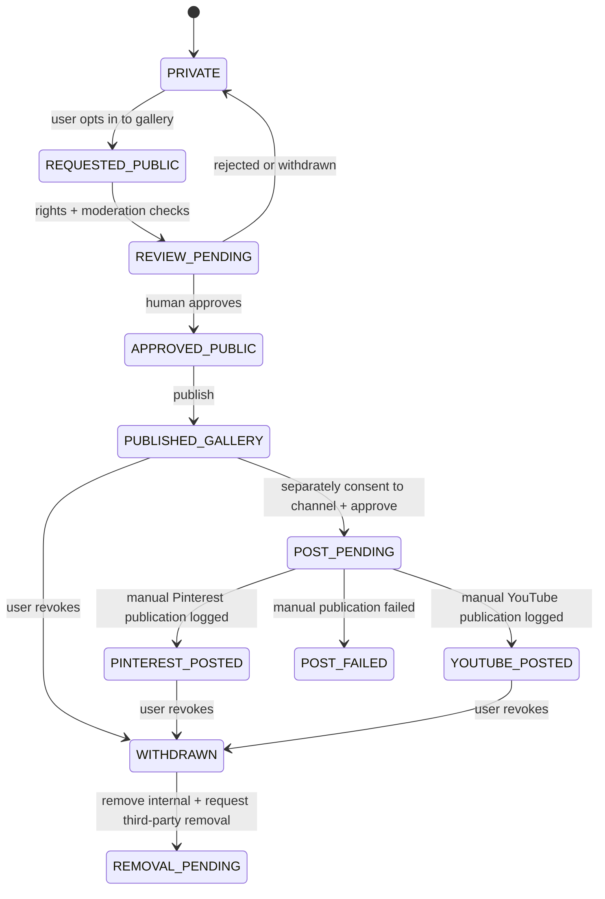

# Content, gallery, consent and publishing specification

## Non-negotiable separate decisions

- **Default `visibility=private`**, persistent and server enforced.
- User may opt into **Public Gallery** for an individual asset or selected asset group, after seeing the exact image/video, intended audience, attribution and withdrawal limitations.
- User may independently opt into **Pinterest** and **YouTube** (video only) distribution. Public-gallery consent alone is insufficient for a social post.
- Editorial reviewers must approve public content and external distribution after rights, moderation, address/PII, EXIF/geolocation and watermark checks.
- User chooses a **public display name or pseudonym** for bottom-right watermark. The profile email, full legal name and address are never automatically disclosed. Preserve full-resolution private originals without watermark.
- Each consent event records asset ID/version, user ID, channel, timestamp, policy version, public name choice and revocation.
- Withdrawal unpublishes from Vastu Nord and starts best-effort authorized social deletion. Track external outcomes; third-party re-shares may persist.

## State diagram

**Channels can coexist;** implement separate publication rows and state machines per platform rather than one exclusive state.

## Knowledge story from consented public render

Proposed story format: title as a question; user's intended effect in general terms; what the image visibly depicts; design narrative; Pros; Cons and trade-offs; limitations and uncertainty; what makes it distinct; related styles/tools; SEO metadata; citations/sources where facts are asserted; attribution if user opted in. Tone: truthful, confident, empathetic, curious, balanced. Do not claim verified building measurements or tested products based on AI output.

**Human approval gate:** AI draft → validation and rights checks → reviewer → approve/revise/reject → Payload versioned publication → optionally schedule authorized social posts. No autonomous unreviewed AI publication.

## v3.2 — Manual social publishing and disabled future port
Payload `Draft → Editorial Review → Approved → Published` is separate from social `Draft → Channel-specific consent and approval → Human upload via official brand account → Publication log / Withdraw`. Pinterest, YouTube, Facebook, Instagram, X and LinkedIn are separately permissioned destinations. No Postiz integration, no social API calls, no automatic posting. Future `SocialPublisherAdapter` may be introduced only after a new explicit owner decision and security review. See `CLOUD_PAYLOAD_AND_MANUAL_SOCIAL.md`.
